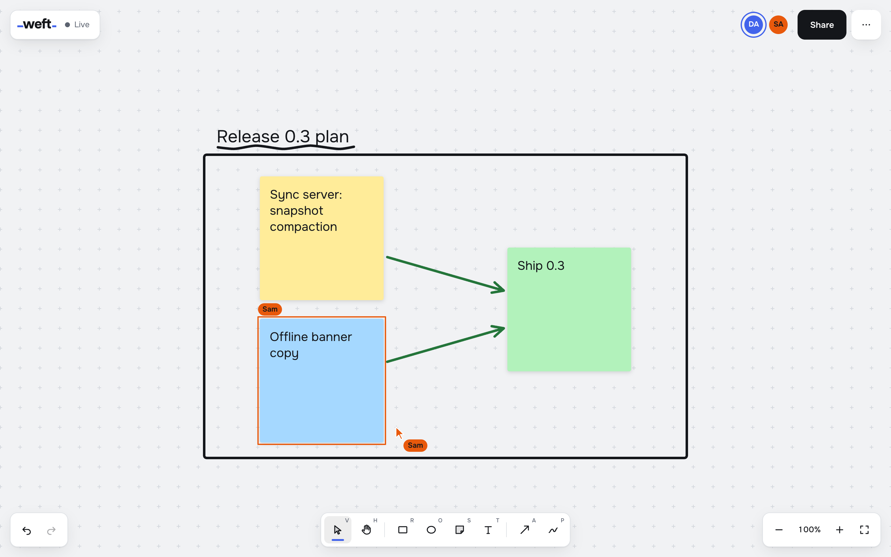
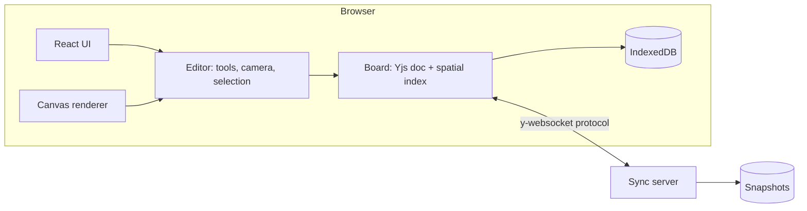

# Weft

**Live demo: [weft-vcbs.onrender.com](https://weft-vcbs.onrender.com)** (free instance, the first visit after a quiet spell takes about 30 seconds to wake it, and boards reset on redeploy)

A multiplayer whiteboard. Open a board, send the link, and draw, write and connect ideas
together in real time. Boards keep working offline and merge when the connection returns.



## Run it

Requires Node 24 and pnpm.

```bash
pnpm install
pnpm dev
```

Open http://localhost:5173, then open the same URL in a second window to see two cursors.

Production, one container serving the app and the sync endpoint on port 8080:

```bash
docker compose up --build
```

## What it does

- Rectangles, ellipses, sticky notes, text, freehand pen and arrows that stay attached to
  shapes as they move
- Frames that group a section of the board and carry their contents when moved
- Images by paste or drag and drop, stored once on the server by content hash
- Follow mode: click a collaborator's avatar and your view tracks theirs
- View-only links: viewers see every change live, and the server drops any edit they send
- Version history: the server snapshots each board every 10 minutes while it changes, and
  any snapshot can be restored as one undoable step
- Live cursors, name tags and each person's selection
- Per-user undo: undo reverts your own edits and never a collaborator's
- Offline editing with IndexedDB; changes sync on reconnect without conflict dialogs
- Copy and paste between boards, duplicate, reorder, nudge, keyboard shortcuts (`?`)
- Pinch zoom and pan on touch devices
- PNG and SVG export of the selection or the whole board
- Every person picks a thread color that becomes their accent: selection, handles,
  cursor and avatar look the same on every screen
- Empty boards offer a sample and a one-click second window to see collaboration
- The home page runs the real editor: two scripted collaborators edit a document that
  syncs between three Yjs replicas in the same tab
- Light and dark themes; shape colors are stored as tokens so each viewer sees a palette
  that suits their theme

## Architecture



| Package         | Role                                                                                     |
| --------------- | ---------------------------------------------------------------------------------------- |
| `packages/core` | Framework-free engine: document model, geometry, spatial index, tools, history, presence |
| `apps/server`   | Node WebSocket relay: merges updates, broadcasts presence, snapshots rooms to disk       |
| `apps/web`      | React shell and Canvas 2D renderer                                                       |

The editor has no DOM dependency. The web app forwards normalized pointer, wheel and key
events and draws whatever state the editor exposes, so every interaction (drawing,
dragging, resizing, binding arrows, pinch zoom, clipboard) is unit tested in Node.

## Engineering notes

**Conflict-free sync.** The document is a Yjs CRDT with one map per shape. Two people
editing different properties of the same shape (one drags it, one recolors it) both keep
their change. Paint order uses fractional indexes, so concurrent reordering never
renumbers the board. Decisions are recorded in [docs/adr](docs/adr).

**Rendering cost tracks the viewport, not the board.** Shapes live in a uniform-grid
spatial index; each frame queries only what is visible, and frames are drawn on demand.
Measured with `pnpm bench` on an Apple M3 laptop, Node 24 (10,000 shapes, 1920×1080 viewport):

| Operation                          | Time   |
| ---------------------------------- | ------ |
| Visible-shape query, spatial index | 9 µs   |
| Same query, linear scan            | 184 µs |
| Visible shapes in paint order      | 18 µs  |
| Move one shape (a drag frame)      | 21 µs  |

Open any board with `?debug` to see live frame timing and add shapes in batches of 2,000.

**Untrusted peers.** Every shape and presence record is validated when read, so a
malformed update from one client cannot break rendering for the room. The server drops
malformed messages, caps message size and terminates dead connections.

**Text editing uses a real textarea** positioned over the shape, so IME, spellcheck and
screen readers work, and each keystroke syncs live.

## Quality

```bash
pnpm check      # format, lint, typecheck, unit tests
pnpm test:e2e   # Playwright: two browser contexts editing one board
pnpm bench
```

- Strict TypeScript (`noUncheckedIndexedAccess`, `erasableSyntaxOnly`), type-aware ESLint
- 127 unit and integration tests, 88% line coverage of core and server; the server is
  tested with real y-websocket clients, including view-only sockets, version history and
  image uploads
- 10 end-to-end tests covering realtime sync, presence, per-user undo, persistence, view-only
  links, frames, follow mode, the sample board and the home page
- CI runs all of the above plus a container build and health check

## Limitations

- No accounts: the edit link is the permission. Anyone with it can edit, anyone with the
  view link can watch.
- Sticky and text content is last-writer-wins per shape; two people typing in the same
  note at the same moment will overwrite each other.
- One server process holds all rooms in memory; horizontal scaling would need a shared
  pub/sub layer between instances.
